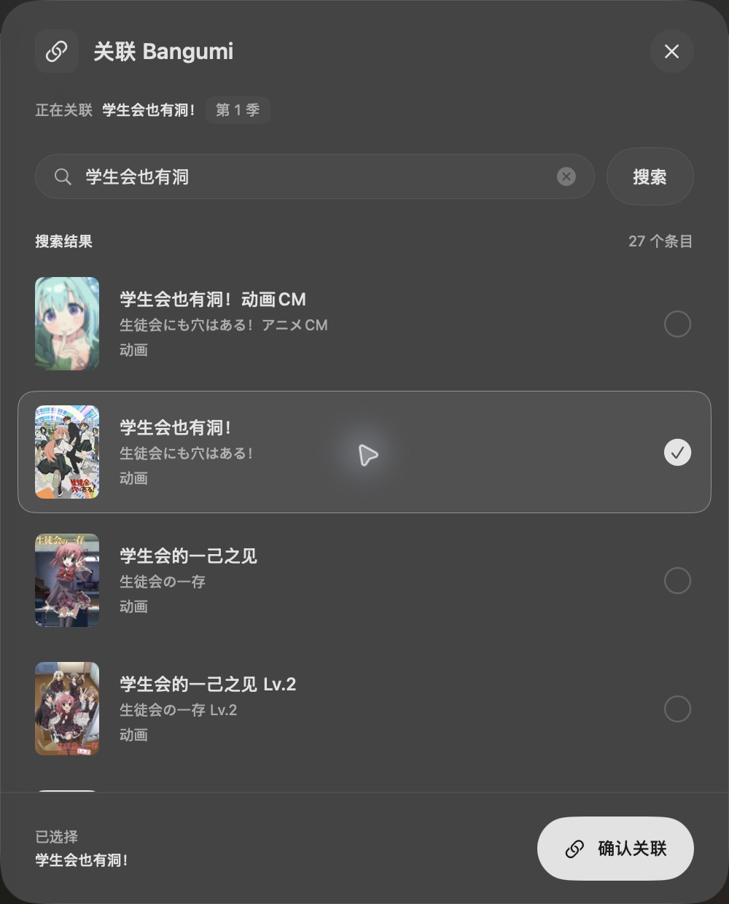

# Bangumi 关联弹窗 review

范围：基于 main 的 `cb45dcf`，检查 `BangumiLinkPicker.swift` 的设计与交互改动。完整季名搜索修复已由 #103 合入，当前 PR 沿用该行为。

结论：未发现阻塞问题。

- 搜索以独立请求标识驱动 `.task(id:)`；编辑或清空关键词会清除结果与选中状态。异步完成时同时检查取消状态和请求身份，旧响应与旧任务的收尾不能覆盖新搜索。
- 候选点击仅更新选择，确认按钮在搜索中或未选中时禁用；确认后调用原有 `onSelect` 并关闭弹窗。Return 与 Escape 保留对应快捷操作。
- macOS 材质仅清除有 `sheetParent` 的弹窗底色，避免修改详情页宿主窗口。系统“减少透明度”设置使用实心回退，文字没有整体降低透明度。
- iOS 不设置 macOS 窗口最小宽度；作品上下文与底部确认区提供纵向布局回退。候选使用稳定条目 ID，海报按 SwiftUI displayScale 下采样。

验证：

| 检查 | 结果 |
| --- | --- |
| PR 分支 macOS 构建与 BangumiMatcherTests | 19/19 通过，无失败或跳过 |
| PR 分支 iOS Simulator 构建与 BangumiMatcherTests | 19/19 通过，无失败或跳过 |
| 同一生产视图的原生验证窗口 | 深浅色、选中、确认回调与关闭、Return、清空、取消均通过 |
| 已安装的 OcPlayer | 真实搜索返回 27 条；选择后确认按钮启用 |
| diff 与依赖锁文件 | `git diff --check` 通过；Package.resolved 无变更 |

原生验证窗口使用固定候选数据；真实 App 验证保留了原有关联，没有提交新的关联。iOS 此次验证覆盖构建与搜索回归，未单独执行模拟器 UI 自动化。

实际 OcPlayer 弹窗截图（单窗口截图展示布局，跨窗口模糊效果以实际 App 为准）：

## 首轮 CI 失败修复

首轮 CI 的 macOS 与 iOS App tests 均在 `SettingsGlassMetricsTests.testNoMaterialCardBackgroundsRemainInFeatures` 失败：全仓扫描把独立关联 sheet 的 `thinMaterial` 呈现背景也计入了页内内容卡。初次本地验证仅覆盖 Bangumi 搜索回归，遗漏了这条样式守卫。

在该背景用法旁使用守卫已有的 `glass-guard-exempt:` 机制，注明独立 sheet 的用途。豁免限定在这一处呈现背景；其余内容卡仍由原检查保护，已确认的视觉效果与交互保持一致。

修复后本地完整 App tests：

| 平台 | 成功 | 失败 | 跳过 | 总数 |
| --- | ---: | ---: | ---: | ---: |
| macOS | 980 | 0 | 19 | 999 |
| iOS Simulator | 1004 | 0 | 3 | 1007 |
