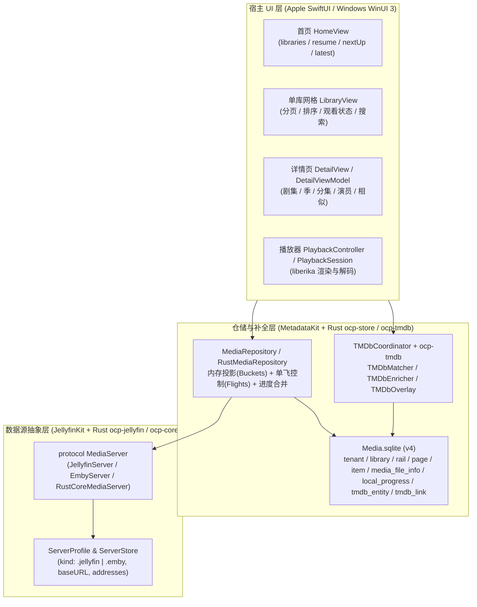
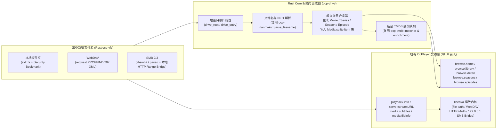
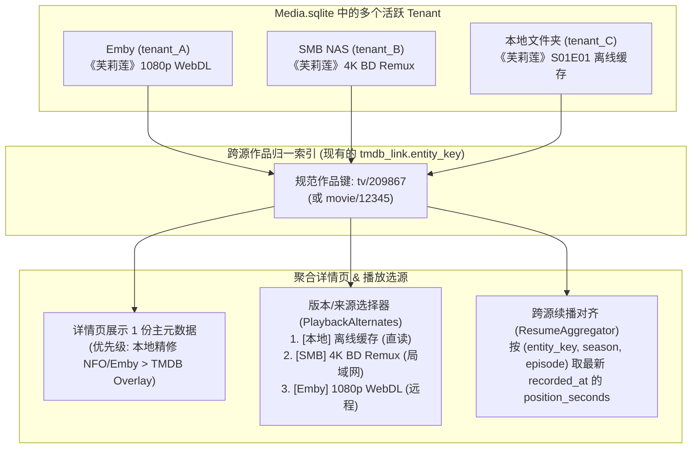

# OcPlayer 媒体库扩展架构分析报告：引入本地媒体库、SMB 与 WebDAV（对标 Rex）

> 基于 `/Users/jumusu/Documents/project/rex_analysis/out/media-library-2026-11-19/MEDIA_LIBRARY_ANALYSIS.md` 对 Rex v1.0.2 的逆向分析，结合 `OcPlayer` 当前三端合仓代码（`core/`、`apps/apple/`、`apps/windows/`）进行逐层对照与架构设计。

---

## 一、OcPlayer 现有媒体库实现全景

`OcPlayer` 目前是一个**以单活媒体服务器（Active MediaServer：Jellyfin / Emby）为中心**的架构，在 Apple 与 Windows 双端共享一套 Rust Core（`core/`）与 SQLite  schema（`Media.sqlite` v4）。

### 1.1 现有四层数据面



1. **领域模型层（`CoreModel/MediaItem.swift`、`MediaLibrary`）**
   - UI 只认 `MediaItem`（纯值类型，`id / name / originalTitle / kind / overview / year / runtimeSeconds / genres / communityRating / seriesID / seasonID / seasonNumber / episodeNumber / playState / cast / *ImageTag / tmdbID / malID / anilistID`）和 `MediaLibrary`（`id / name / collectionType / primaryImageTag`）。
   - `MediaItem` **刻意不含绝对 URL**，图片和流地址在渲染/起播时结合当前 `MediaServer` 的 `baseURL` 现场拼装。
2. **数据源抽象层（`JellyfinKit/MediaServer.swift`、`ServerStore.swift`、`ocp-jellyfin`）**
   - `ServerKind` 枚举目前仅支持 `.jellyfin` 与 `.emby`。
   - `MediaServer` 协议定义了 20+ 个契约方法：浏览（`userViews`、`latestItems`、`resumeItems`、`nextUp`、`itemsPage`）、详情（`item`、`seasons`、`episodes`、`chapters`、`similar`）、资源与播放（`imageURL`、`streamURL`、`playbackInfo`、`mediaFileInfo`、`externalSubtitles`、`mediaSegments`）以及进度上报（`PlaybackReporting`）。
   - Apple 侧通过 `RustCoreMediaServer` 包装原生 `MediaServer`，将 JSON 命令（`browse.*`、`playback.info`、`media.*`、`report.*`）转发给 Rust Core；Windows 侧 `Services/MediaServer.cs` 直接调 `OcpCoreClient.CallJSONAsync("browse.*", ...)`。
3. **缓存与数据面（`MetadataKit/MediaRepository.swift`、`ocp-store`、`Media.sqlite` v4）**
   - **租户隔离**：所有 SQLite 表（`item`、`library`、`rail`、`page`、`media_file_info`、`local_progress`、`tmdb_link`）均以 `tenant_id`（即 `ServerProfile.id` = `serverID:userID`）为分区主键。
   - **本地进度保护**：`local_progress` 表（v4 已解除与 `item` 表的外键级联删除）支持离线/未确认的本地末次播放进度在网络回包合并时优先胜出。
4. **TMDB 匹配与叠加层（`MetadataKit/TMDb`、`ocp-tmdb`）**
   - **只读叠加（`TMDbOverlay`）**：不直接篡改 `MediaItem`，而是在 `tmdb_link(tenant_id, item_id -> entity_key)` 与 `tmdb_entity(entity_key, language -> payload)` 中保存关联与实体，展示时由 `DisplayMetadata` 动态叠加标题、简介、演员、海报、分集名。
   - **已有完整的匹配与解析积木**：`ocp-tmdb/src/matcher.rs` 已实现标题归一化、年份提取、候选打分（`AUTO_APPLY_THRESHOLD = 0.85`）；`ocp-danmaku/src/filename.rs` 已实现 `parse_filename`（从原始文件名中剥离字幕组、分辨率、编码标签，精准提取 `title`、`season_number`、`episode_number`）。
5. **播放引擎边界（`ErikaKit` / `liberika`、`DirectLinkInput.swift`、`PlaybackRequest.swift`）**
   - `liberika` 的 `erika_presenter_open_with_options(handle, uri, options)` 原生支持**本地文件绝对路径**和**带自定义 `ErikaHttpHeader` 的 HTTP/HTTPS 流**。
   - `liberika` **不直接支持 `smb://` 协议**（`DirectLinkInput.swift` 明确拦截了 `smb:` / `ftp:`）。
   - 本地单文件播放目前只能通过 `⌘O`（`fileImporter` + `securityScopedURL`）临时打开，播放记录写入 `AppPlaybackHistoryStore`（`sourceID = "local"`，`id = "local:<sha256>"`），**不进入 `Media.sqlite`，也没有海报墙、剧集归组或首页「继续观看」**。

---

## 二、对标 Rex：OcPlayer 缺少哪些核心机制？

将 Rex v1.0.2 的媒体库实现（见 `rex_analysis/out/media-library-2026-11-19/MEDIA_LIBRARY_ANALYSIS.md`）与 `OcPlayer` 现有代码对照，差距集中在以下 5 个维度：

| 维度 | Rex v1.0.2 实现方式 | OcPlayer 当前现状 | 核心差距 |
|---|---|---|---|
| **1. 数据源注册模型** | 统一 `CatalogRecord`（`emby / jellyfin / plex / webdav / smb / pan115 / localFolder`），每个源有独立的 `CatalogID` 与凭据空间 | `ServerProfile` 仅支持 `jellyfin \| emby`，强制要求 `baseURL: http(s)://` 和 `userID` | 缺少非 HTTP 服务器源（`localFolder`、`smb`、`webdav`）的档案模型与授权凭据存储 |
| **2. 文件系统枚举与索引** | `WebDAVDriveFileProvider`（PROPFIND 207）与 `SMBDriveFileProvider`（libsmb2）枚举文件树，写入 `DriveEntryRecord`（路径、父路径、大小、mtime、状态） | **无**。仅支持 `⌘O` 打开单个本地文件 | 缺少虚拟文件系统（VFS）遍历器与本地文件树持久化表 |
| **3. 本地刮削与季/集聚合** | `DriveScrapeCoordinator` 消费未刮削的视频文件 → 文件名解析 → TMDB 匹配 → 生成虚拟剧集/季/分集（`MediaRecord` + `DriveSeasonCacheRecord`） | 已有 `ocp-danmaku::parse_filename` 和 `ocp-tmdb::matcher`，但**只能对已存在的 `MediaItem` 做被动 Overlay** | 缺少**从裸文件生成 `MediaItem` 树（Series → Season → Episode / Movie）**的本地索引与刮削器 |
| **4. 播放协议桥接（SMB/WebDAV/Local）** | WebDAV 走带 Auth Header 的 HTTP 直链；SMB 走 `RexSMBIOContext`（FFmpeg 自定义 `AVIOContext` 调 `libsmb2`）；本地文件夹走 `Security-Scoped Bookmark` | `liberika` 支持本地路径与带自定义 Header 的 HTTP(S)，不支持 `smb://`；`PlaybackRequest` 只支持单文件 `securityScopedURL` | WebDAV 与本地文件夹可直接喂给 `liberika`；**SMB 需要在 Rust Core 内建轻量本地 HTTP Range 代理桥接给 `liberika`** |
| **5. 多源与 Emby/Jellyfin 共存** | 支援并行挂载多个 Catalog；通过 `work-identities-v2.sqlite`（`(kind, tmdb_id)`）聚合多源版本，通过 `ResumeAggregator` 聚合续播 | `AppModel.server` 是单活实例（每次只能激活一个 `ServerProfile`），但 `Media.sqlite` 底层天然支持多 `tenant_id` 并存 | 短期可完美复用「单活 Profile / Tenant 切换」实现零侵入共存；中期可基于 `tmdb_link.entity_key` 实现跨源版本聚合与联合首页 |

---

## 三、总体架构主张：如何以最小侵入度在 OcPlayer 中落地？

`OcPlayer` 最宝贵的资产是已经高度收敛并经过严苛验证的 **`MediaServer` 协议 + `MediaRepository` 数据面 + `Media.sqlite` (按 `tenant_id` 隔离) + `TMDbOverlay` + `liberika` 播放器**。

因此，引入本地媒体库、SMB 和 WebDAV **绝对不应该在 UI 层另起炉灶写第二套浏览/详情/缓存逻辑**，而应当遵循以下两条核心架构原则：

1. **在 Core 与数据源层将「本地文件夹 / SMB / WebDAV」统一收敛为 `VirtualDriveMediaServer`（实现 `MediaServer` 协议 / Rust `browse.*` 命令）**：
   - 对 `AppModel`、`MediaRepository`、`HomeView`、`LibraryView`、`DetailView` 而言，一个本地文件夹库、一个 SMB 共享或一个 WebDAV 目录，**在契约上就是一台本地自托管的 `MediaServer`（拥有自己的 `ServerProfile` 和 `tenant_id`）**。
   - 它的 `userViews()`、`latestItems()`、`resumeItems()`、`nextUp()`、`itemsPage()`、`seasons()`、`episodes()` 全部由 Rust Core 的本地 SQLite 索引（`drive_entry` + `item` + `local_progress` + `tmdb_entity`）直接计算返回！
2. **复用 OcPlayer 已有的 Rust 文件名解析器（`ocp-danmaku::filename`）+ TMDB 匹配器（`ocp-tmdb::matcher`）构建「入库即合成」管线**：
   - 文件扫描器枚举出视频文件后，先在本地用 `parse_filename` 提取片名、季号、集号，自动在 `Media.sqlite` 的 `item` 表中合成 `movie` 或 `series -> season -> episode` 階層结构；接着复用 `ocp-tmdb` 自动关联 `tmdb_link` 与 `tmdb_entity`。



---

## 四、分模块详细设计方案

### 4.1 档案与连接模型扩展（`ServerKind` 与 `ServerProfile`）

在不破坏现有 `ServerProfile` JSON 兼容性的前提下，扩展 `ServerKind`：

```swift
// apps/apple/Packages/JellyfinKit/Sources/JellyfinKit/ServerStore.swift
public enum ServerKind: String, Codable, Sendable {
    case jellyfin
    case emby
    case webdav
    case smb
    case localFolder
}
```

各类型在 `ServerProfile` 与 `TenantID` 中的映射规则：

| `ServerKind` | `profile.id` (`tenant_id`) 生成规则 | `baseURL` 形态 | 凭据存储（Keychain / PasswordVault / `CredentialFileStore`） |
|---|---|---|---|
| `.jellyfin` / `.emby` | `<serverID>:<userID>` | `http(s)://host:port[/emby]` | `accessToken` |
| `.webdav` | `webdav:<sha256(baseURL + userID)>` | `http(s)://host:port/dav/path` | Basic Auth (`username:password`) 或 Bearer Token |
| `.smb` | `smb:<sha256(host + share + path + userID)>` | `smb://host[:port]/share[/subpath]` | SMB 用户名、密码、可选 Domain/Workgroup |
| `.localFolder` | `local:<sha256(canonicalRootPath)>` | `file:///abs/path/to/folder` | Apple 端保存 **Security-Scoped Bookmark Data**；Windows 端直接使用持久路径 |

- **为什么这样设计**：
  - 现有的 `TenantID(profile:)` 直接拿 `profile.id` 作为 `Media.sqlite` 的 `tenant_id`。
  - 当用户添加一个 WebDAV、SMB 或本地文件夹时，它天然获得一个独立的 `tenant_id`，其条目（`item`）、播放进度（`local_progress`）、TMDB 绑定（`tmdb_link`）、首页栏目（`rail`）在 `Media.sqlite` 中与 Jellyfin/Emby **同库同表、天然隔离、零冲突**。

---

### 4.2 虚拟文件系统接入层（新建 Rust Crate：`ocp-vfs` 或 `ocp-drive`）

借鉴 Rex 的 `DriveFileProvider` 抽象，在 Rust Core 中定义一个统一的只读文件系统 Trait：

```rust
#[derive(Debug, Clone, Serialize, Deserialize)]
pub struct VfsEntry {
    pub uri: String,          // 规范化相对路径或完整 URI
    pub parent_uri: String,
    pub name: String,
    pub is_dir: bool,
    pub size: Option<i64>,
    pub mtime: Option<i64>,   // Unix 秒，用于增量扫描判定
}

#[async_trait]
pub trait VirtualFileSystem: Send + Sync {
    /// 列出单层目录内容（供按需展开或 BFS 扫描）
    async fn read_dir(&self, dir_uri: &str) -> Result<Vec<VfsEntry>, VfsError>;
    /// 读取小文件字节（用于读取同目录下的 .nfo、.srt/.ass 外挂字幕、poster.jpg）
    async fn read_bytes(&self, file_uri: &str, max_bytes: usize) -> Result<Vec<u8>, VfsError>;
    /// 打开字节范围流（专供 SMB 本地 HTTP Range 桥接器使用）
    async fn open_range(&self, file_uri: &str, start: u64, end: Option<u64>) -> Result<BoxStream, VfsError>;
}
```

#### 1. 本地文件夹（`LocalFolderVfs`）
- **目录遍历**：Rust `std::fs::read_dir` 即可，速度极快（万级文件毫秒级扫描）。
- **Apple 沙盒与权限（关键细节）**：
  - macOS / iOS 通过 `fileImporter(allowedContentTypes: [.folder])` 选择文件夹后，系统返回的是带临时权限的 `URL`。
  - 必须像 Rex 的 `LocalFolderAccessSession` 一样，调用 `url.bookmarkData(options: .withSecurityScope)`（iOS 用 `.minimalBookmark`）将 Bookmark 字节持久化到 `ServerStore`。
  - 每次激活该本地媒体库会话（`activate(server:)`）时，在宿主侧 `URL(resolvingBookmarkData:options:.withSecurityScope)` 并调用 `startAccessingSecurityScopedResource()`，会话保持期间长持该权限句柄（直到 `resetBrowseState()` 或 `signOut()` 时 `stopAccessingSecurityScopedResource()`），从而让 Rust Core 的 `std::fs` 和 `liberika` 的文件读取畅通无阻。
- **Windows 权限**：WinUI 3 非打包/常规桌面进程通过 `FolderPicker` 获取路径后，直接以标准 Win32 路径传给 Rust Core 即可。

#### 2. WebDAV 媒体库（`WebDavVfs`）
- **协议实现**：完全复用 `core` 现有的 `reqwest`（`ocp-http`），无需引入重型第三方依赖，仅需增加一个轻量 XML 解析器（如 `quick-xml` 或针对 `D:response` 的轻量解析）处理 `PROPFIND`（`Depth: 1`）返回的 `207 Multi-Status`：
  - 提取 `<d:href>`、`<d:getcontentlength>`、`<d:getlastmodified>`、`<d:resourcetype><d:collection/></d:resourcetype>`。
- **播放直通（零代理开销！）**：
  - WebDAV 本质就是 HTTP/HTTPS！
  - `liberika` 的 `erika_presenter_open_with_options` 原生支持传入 `ErikaHttpHeader`（例如 `Authorization: Basic <base64>`）以及 `http_read_ahead_bytes` / `http_back_buffer_bytes`。
  - 因此 **WebDAV 视频播放完全不需要本地代理**：`server.streamURL` 直接返回 WebDAV 文件的 `http(s)://...` URL，`authorizationHeader` 返回 `Basic ...`，`liberika` 直接带着 Auth Header 发起 HTTP Range 流式播放！
  - 同样，如果目录下有 `poster.jpg` / `fanart.jpg`，`ImagePipeline` 也已经原生支持带 `authHeader` 请求图片。

#### 3. SMB 媒体库（`SmbVfs` + 本地 Loopback Range Bridge）
- **Rex 的做法与 OcPlayer 的差异**：
  - Rex 修改了 KSPlayer/FFmpeg 源码，通过 `RexSMBIOContext`（`avio_alloc_context`）将 `libsmb2` 的 `smb2_pread` 直接挂进 FFmpeg 解封装层。
  - 但在 `OcPlayer` 中，`liberika` 是外部预编译的 C ABI 二进制（`erika.h` 只接受 `const char *uri` + `ErikaOpenOptions` 的 HTTP headers，**没有暴露自定义 `AVIOContext` 回调接口**）。
- **OcPlayer 的最佳工程解：Rust Core 内建 Loopback HTTP Range 桥接器（`127.0.0.1:<ephemeral_port>`）**
  - 在 Rust Core 中集成 `libsmb2` 绑定（或纯 Rust SMB2/3 客户端）：
    1. **浏览与刮削期**：通过 SMB 协议执行 `opendir` / `readdir` 枚举目录树，读取 `.nfo` 和外挂字幕（`.srt` / `.ass`）。
    2. **起播期**：当播放某个 SMB 视频条目时，Rust Core 在 `127.0.0.1` 启动一个绑定随机端口、带一次性随机 Session Token 的极简异步 HTTP Range 服务（基于 `tokio::net::TcpListener`）：
       - `server.streamURL` 返回 `http://127.0.0.1:<port>/stream/<session_token>/<item_id>.mkv`。
       - `liberika` 对该本地 HTTP 地址发起带 `Range: bytes=start-end` 的请求（利用 `liberika` 现有的 `http_read_ahead_bytes` 预读缓冲和 `http_back_buffer_bytes` 16MB 回退缓冲）。
       - Loopback 服务将 HTTP Range 翻译为 SMB2 的 `smb2_lseek` + `smb2_read`（或 `pread`），通过本地回环 socket 零延迟喂给 `liberika`。
    3. **优势**：**无需修改 `liberika` 一行代码**，Apple 与 Windows 双端一次性同时获得 SMB 2/3 流式播放、HDR/杜比视界硬解、无头抽帧截图（`erika_export_frame`）全部能力！

---

### 4.3 数据库 Schema 演进与「目录扫描 → 虚拟条目合成 → TMDB 刮削」管线

在 `core/schema/` 下新增 `media_v5.sql` 迁移，不破坏 v1~v4 的任何表，仅新增两张用于文件源索引的表：

```sql
-- core/schema/media_v5.sql

-- 1. 挂载根文件夹（一个本地/SMB/WebDAV tenant 下可以挂载多个子目录作为不同的 MediaLibrary）
CREATE TABLE drive_folder(
  tenant_id TEXT NOT NULL,
  library_id TEXT NOT NULL,
  name TEXT NOT NULL,
  root_uri TEXT NOT NULL,
  collection_type TEXT NOT NULL DEFAULT 'unknown', -- 'movies' | 'tvshows' | 'unknown' (混合)
  last_scanned_at INTEGER,
  scan_status TEXT NOT NULL DEFAULT 'idle',
  PRIMARY KEY(tenant_id, library_id)
);

-- 2. 原始文件与目录树索引（对标 Rex 的 DriveEntryRecord）
CREATE TABLE drive_entry(
  tenant_id TEXT NOT NULL,
  entry_id TEXT NOT NULL,        -- sha256(tenant_id + "|" + uri)
  library_id TEXT NOT NULL,
  uri TEXT NOT NULL,
  parent_uri TEXT NOT NULL,
  name TEXT NOT NULL,
  extension TEXT,
  kind TEXT NOT NULL,            -- 'directory' | 'video' | 'subtitle' | 'nfo' | 'artwork'
  size_bytes INTEGER,
  modified_at INTEGER,
  item_id TEXT,                  -- 关联到 item(tenant_id, item_id) 的合成条目 ID
  scrape_state TEXT NOT NULL DEFAULT 'pending', -- 'pending' | 'matched' | 'unmatched' | 'failed'
  updated_at INTEGER NOT NULL,
  PRIMARY KEY(tenant_id, entry_id)
) WITHOUT ROWID;

CREATE INDEX drive_entry_parent ON drive_entry(tenant_id, library_id, parent_uri);
CREATE INDEX drive_entry_item ON drive_entry(tenant_id, item_id);
CREATE INDEX drive_entry_scrape ON drive_entry(tenant_id, scrape_state);
```

#### 三步入库与刮削流水线（对标 Rex `DriveScrapeCoordinator`，但直接复用 `OcPlayer` 现有表）：

1. **第一步：增量文件树扫描（Fast Scan）**
   - 遍历 `drive_folder` 指定的 `root_uri`。
   - 对比 `drive_entry` 中目录/文件的 `modified_at` 与 `size_bytes`：未变化的跳过，新增/修改的视频文件（`mkv/mp4/avi/mov/ts/m2ts/iso/strm` 等）、同名字幕（`srt/ass/ssa/vtt`）、本地元数据（`nfo`、`poster.jpg`、`fanart.jpg`）写入 `drive_entry`，并将已删除文件的记录清理。
2. **第二步：本地即时合成 `MediaItem`（Zero-Network Instant Synthesis）**
   - **不等 TMDB 网络请求完成，扫描完立即生成可浏览、可播放的 `MediaItem` 写入 `item` 表**（保证断网或未配 TMDB Key 时本地库也完全可用！）：
     - 若存在 Kodi/Jellyfin 标准 `.nfo`（`movie.nfo`、`tvshow.nfo`、`<episode>.nfo`）：优先从 XML 提取 `<title>`、`<originaltitle>`、`<year>`、`<plot>`、`<season>`、`<episode>`、`<tmdbid>`。
     - 若无 `.nfo`：直接调用 `ocp-danmaku::filename::parse_filename`（以及父目录名解析）：
       - **判定为剧集分集**（解析出 `episode_number` 或父目录符合季/剧结构）：
         - 按规范化 `series_title` 生成确定性 `series_id = "series:<sha256(library_id + series_title)>"`，在 `item` 表 upsert 一条 `kind = "series"` 的 `MediaItem`。
         - 按 `(series_id, season_number ?? 1)` 生成确定性 `season_id = "season:<sha256(series_id + season_num)>"`，在 `item` 表 upsert 一条 `kind = "season"` 的 `MediaItem`。
         - 为当前视频文件生成 `item_id = entry_id`，`kind = "episode"`，填入 `seriesID`、`seasonID`、`seasonNumber`、`episodeNumber`，写入 `item` 表。
       - **判定为电影/独立视频**（无集号且所属库非强制剧集库）：
         - 生成 `item_id = entry_id`，`kind = "movie"`，标题取清洗后的 `title`，年份取 `matcher::year(&raw_name)`，写入 `item` 表。
3. **第三步：自动触发 TMDB 批量匹配与补全（复用 `ocp-tmdb`）**
   - 合成出 `movie` 和 `series` 条目后，直接复用 `ocp-tmdb/src/enrichment.rs` 现有的 **`batch.begin`（并发度 `BATCH_WIDTH = 4`）** 调度器！
   - `TMDbMatcher` 自动对 `movie` 和 `series` 搜索 TMDB，写入 `tmdb_link(tenant_id, item_id -> entity_key)`，拉取 `tmdb_entity`（以及剧集对应的 `tv/{id}/season/{s}` 分集元数据）。
   - **无缝衔接现有 `TMDbOverlay`**（或可选将高置信度匹配写回 `item.payload`）：
     - 在详情页，现有的 `DetailViewModel` 会自动读取 `tmdb_link` 和 `tmdb_entity` 构造 `TMDbOverlay`，分集的占位标题（如文件名）、简介、分集剧照（`episodeStillPath`）、演员表、评分瞬间全部补齐！
     - 在首页和网格列表页：因为文件源本身没有 Jellyfin 服务端下发的 `primaryImageTag`，只需在合成阶段或 TMDB 匹配完成后，把 `tmdb_entity` 的 `posterPath` / `backdropPath`（或同目录的本地 `poster.jpg` 路径）映射到 `MediaItem` 的图片解析逻辑（见 4.4），网格海报墙就能直接渲染出高清海报。

---

### 4.4 `browse.*` / `MediaServer` 契约在本地/SMB/WebDAV 源上的映射

当 `ServerProfile.kind` 为 `.localFolder` / `.smb` / `.webdav` 时，Rust Core 的 `browse.*`、`media.*`、`playback.*` 命令无需发起 Jellyfin HTTP 请求，而是直接查询 `Media.sqlite` 中对应 `tenant_id` 的表：

| 现有契约命令 / `MediaServer` 方法 | 在本地 / SMB / WebDAV 源上的实现方式 |
|---|---|
| `userViews()` / `browse.home` (`libraries`) | 读取 `drive_folder` 表（若用户只挂载了一个根目录，默认生成一个库；也支持像 Plex/Infuse 一样在一个 SMB 连接下勾选多个文件夹作为「电影」「番剧」等多个 `MediaLibrary`）。同时提供**「文件夹视图（Folder Browser）」**入口，支持按 `drive_entry` 的 `parent_uri` 逐级浏览原始目录。 |
| `latestItems()` / `browse.latest` | `SELECT payload FROM item WHERE tenant_id=?1 AND kind IN ('movie','series') ORDER BY fetched_at DESC LIMIT ?2`（按文件 `modified_at` 入库时间倒序）。 |
| `resumeItems()` / `browse.resume` | 直接查询 `local_progress` JOIN `item`：`WHERE tenant_id=?1 AND completed=0 AND position_seconds > 0 ORDER BY recorded_at DESC`。 |
| `nextUp()` / `browse.nextUp` | 从 `local_progress` 中找到最近观看的 `episode` 所属的 `series_id`，在 `item` 表中查找同一 `series_id` 下按 `(season_number, episode_number)` 紧随其后的第一集未看分集！ |
| `itemsPage(...)` / `browse.library` | 直接在 SQLite `item` 表上执行分页查询：按 `library_id`、`kinds`（`movie` / `series`）、`watchState`（`played`）、`searchTerm`（`name LIKE %term%`）、`sort`（名称/年份/评分/修改时间）返回 `MediaItemsPage`。 |
| `seasons(seriesID:)` / `episodes(seriesID:seasonID:)` | 直接复用 `ocp-store/src/cache.rs` 现有的 `cache.seasons` 与 `cache.episodes` SQL 查询（`item` 表已有 `item_series` 与 `item_season` 索引）！ |
| `imageURL(itemID:type:maxWidth:tag:)` | 优先级：① 若目录下存在本地同名图片/`poster.jpg`/`fanart.jpg`，返回本地文件/缓存 URL；② 若 `tmdb_link` + `tmdb_entity` 已有 `posterPath` / `backdropPath` / `stillPath`，直接返回 TMDB 图片 URL；③ 未匹配到 TMDB 的单集视频，可按需调用 `liberika` 的 `erika_export_frame` 在视频 10% 处截取一帧 PNG 存入本地图片缓存。 |
| `playbackInfo(itemID:)` & `streamURL(...)` | 从 `drive_entry` 取出视频 `uri`：本地文件返回绝对路径；WebDAV 返回 HTTP(S) URL（配合 Basic Auth Header）；SMB 启动/复用 Loopback Range Bridge 返回 `http://127.0.0.1:<port>/...`。若同一剧集/电影下挂载了多个分辨率文件，作为多个 `PlaybackMediaSource` 返回，天然接入现有的切源与故障换源（`PlaybackAlternate`）！ |
| `externalSubtitles(itemID:)` | 查询 `drive_entry` 中同一 `parent_uri` 下与视频文件同前缀的 `.srt / .ass / .ssa / .vtt` 文件，返回 `[ExternalSubtitle]`；播放时调用 `VirtualFileSystem::read_bytes` 下载到本地临时字幕目录交由 `liberika` 加载。 |
| `reportPlaybackStart / Progress / Stopped` | 本地/SMB/WebDAV 源无需向远端媒体服务器发 HTTP POST，直接 no-op（播放进度已由 `MediaRepository.finishPlaybackProgress` / Windows `progress.save` 自动写入 SQLite `local_progress` 和 `item` 表，并同时记入 `AppPlaybackHistoryStore` 与 Bangumi 同步）。 |

---

## 五、本地媒体库、SMB、WebDAV 与 Emby / Jellyfin 如何共存？

参考 Rex 的共存架构，并结合 `OcPlayer` 现有的代码结构，推荐采用 **「两阶段演进」** 的共存方案：

### 阶段一：多租户并列 + 秒级切换（零 UI 结构推翻，立即可用）

`OcPlayer` 目前已经具备完整的多服务器档案管理（Apple 端的 `ServerStore` + `ServersView`；Windows 端的 `ServerProfiles`）：

1. **统一收纳进「数据源 / 媒体库连接」列表**：
   - `ServerStore.profiles` 中可以同时保存：
     - 1 台 Jellyfin 服务器（`tenant_id = "jf_server_id:user_id"`）
     - 1 台 Emby 服务器（`tenant_id = "emby_server_id:user_id"`）
     - 1 个 SMB 家庭 NAS 共享（`tenant_id = "smb:a1b2c3..."`）
     - 1 个 Alist / OpenList WebDAV 挂载（`tenant_id = "webdav:d4e5f6..."`）
     - 1 个 Mac/iPad 本地文件夹库（`tenant_id = "local:7890ab..."`）
2. **数据面零冲突并存**：
   - 所有源共用同一个 `Media.sqlite` 和同一个 `TMDb` 实体缓存表（`tmdb_entity` 是跨租户按 `(entity_key, language)` 共享的！也就是说，Jellyfin 里刮削过的《葬送的芙莉莲》TMDB 数据，切到 SMB 或本地文件夹媒体库时**直接命中本地 SQLite `tmdb_entity` 缓存，零重复网络请求**）。
   - 每个源拥有自己独立的 `item`、`library`、`local_progress` 和 `tmdb_link`。
3. **顶栏 / 侧栏一键切换数据源**：
   - 在首页左上角或顶栏增加一个轻量的「当前数据源切换器（Source Switcher Menu）」，点击即可在 Jellyfin、Emby、SMB、WebDAV、本地库之间秒级切换（由于 `hydrateBrowserDataFromCache` 先读 `Media.sqlite`，切换数据源首屏完全是毫秒级零等待渲染）。

### 阶段二：跨源聚合模式（对标 Rex 的 `MediaWorkIdentityStore` + `AggregatingMediaDetailsProvider`）

当用户希望**不切换服务器，直接在同一个首页和详情页里同时看到 Emby、SMB 和本地文件夹里的内容**时，可在阶段一的基础上开启「聚合视图（Unified Catalog View）」：



1. **现成的跨源归一化主键：`tmdb_link.entity_key`**：
   - Rex 专门建了一个 `work-identities-v2.sqlite` 来对齐 `(kind, tmdb_id)`。
   - 而在 `OcPlayer` 的 `Media.sqlite` 中，**`tmdb_link` 表已经有 `(tenant_id, item_id, entity_key)`（例如 `tv/209867`、`movie/872585`）且建有索引 `tmdb_link_entity`！**
   - 只要在 `item` 表中把 Emby/Jellyfin 条目自带的 `tmdbID` 也自动同步写入 `tmdb_link`，那么跨所有租户（Emby + Jellyfin + SMB + WebDAV + 本地文件夹）具有相同 `entity_key` 的条目就天然指向同一部作品！
2. **详情页多源版本合并（`PlaybackAlternate` 天然承接）**：
   - 当点进 `tv/209867` 的第 1 集时，聚合仓储查询所有活跃 `tenant_id` 下绑定到 `tv/209867` 且 `season_number = 1, episode_number = 1` 的分集。
   - 把这些来自不同源的分集包装成 `OcPlayer` 现有的 **`PlaybackRequest.alternates: [PlaybackAlternate]`**（例如：`[本地文件夹 · 4K]`、`[SMB · 原盘 Remux]`、`[Emby · 1080p]`）。
   - **完全复用 `OcPlayer` 现有的播放页换源菜单与失败自动换源状态机（`ocp-session::preparation`）**！如果本地或 SMB 在外出时不可达，播放器会自动无缝切到 Emby 远程源播放！
3. **跨源播放进度同步**：
   - 在 Emby 上看到了第 3 集 12:30，切回家里的 SMB 4K 原盘点播放第 3 集时，通过 `(entity_key, season_number, episode_number)` 查询各租户 `local_progress` / `item.position_seconds` 中时间戳最新的一条作为 `resumeSeconds`，实现和 Rex `ResumeAggregator` 相同的跨源无缝续播体验。

---

## 六、分阶段实施路线图（Roadmap）

为了保证每一步都可独立测试、不破坏现有 Emby/Jellyfin 稳定性，建议按以下 4 个里程碑推进：

| 阶段 | 目标 | 核心改动文件 / 模块 | 预估工作量 |
|---|---|---|---|
| **Phase 1：本地文件夹媒体库闭环** | 支持添加本地文件夹作为持久化媒体库，自动扫描视频/字幕/NFO、合成剧集/电影结构、自动触发 TMDB 刮削、支持海报墙浏览与续播 | 1. `core/schema/media_v5.sql`（新增 `drive_folder`、`drive_entry`）<br>2. `core/crates/ocp-store` & `ocp-core`（本地目录扫描 + `parse_filename` 合成 `item` + 本地 `browse.*` 投影）<br>3. `JellyfinKit/ServerStore.swift` & `Windows/ServerProfiles.cs`（新增 `.localFolder` 及 Security-Scoped Bookmark 保存）<br>4. Onboarding / 设置页新增「添加本地媒体库」入口 + 原始文件夹浏览页 | 3 ~ 4 天 |
| **Phase 2：WebDAV 媒体库接入** | 支持连接 Alist / OpenList / 群晖 / Nextcloud 等 WebDAV 服务，刮削入库并通过 `liberika` HTTP Header 直连播放 | 1. `core/crates/ocp-http` 或 `ocp-drive`（实现 WebDAV `PROPFIND` Depth 1 解析与 Basic Auth）<br>2. `server.streamURL` 与外挂字幕下载对接 WebDAV HTTP 直链<br>3. 登录/添加数据源弹窗增加 WebDAV 表单（地址、路径、账号、密码） | 2 ~ 3 天 |
| **Phase 3：SMB 2/3 媒体库与本地 Range 桥接** | 支持局域网 SMB 共享目录挂载、增量扫描刮削，以及通过 Rust Core Loopback HTTP Range Bridge 喂给 `liberika` 播放 | 1. `core` 引入 SMB2 客户端层 + `127.0.0.1` 随机端口 HTTP Range 代理服务<br>2. `playback.info` / `server.streamURL` 为 SMB 源分配 Loopback 流地址<br>3. 登录/添加数据源弹窗增加 SMB 表单（主机、共享名、路径、账号、密码） | 3 ~ 5 天 |
| **Phase 4：多源共存切换器与跨源版本聚合** | 顶栏快速切换数据源；基于 `tmdb_link.entity_key` 把同片多源（Emby + SMB + 本地）合并为 `PlaybackAlternate` 线路，支持跨源续播与故障自动换源 | 1. `AppModel` / `HomeView` 顶栏数据源快速切换器<br>2. `ocp-store` 跨 tenant 聚合查询（按 `entity_key` 聚合详情与 `resumeSeconds`）<br>3. `ocp-session::preparation` 将多租户同集候选注入 `PlaybackAlternate` | 3 ~ 4 天 |
