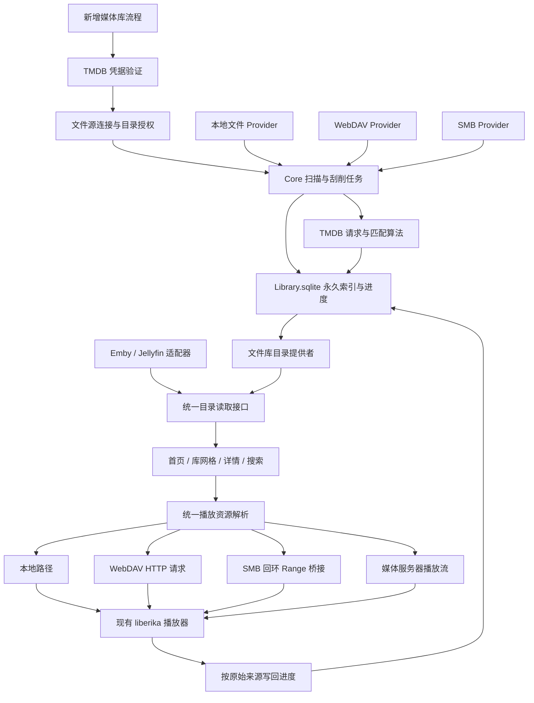

# OcPlayer 文件媒体库实现方案 V2

日期：2026-11-19。代码基线：`9a2b089ebcf8c3394b9fe047a6a0a3d4b7ebba7a`。

本方案覆盖本地文件夹、SMB、WebDAV 的媒体库创建、索引、TMDB 刮削、浏览、播放、进度，以及它们与 Emby/Jellyfin 的共存。它是下一轮开发的实施设计，文中的新增模块、表和命令均尚未实现。

原 [扩展分析报告](/Users/jumusu/Documents/project/OcPlayer/docs/MEDIA-LIBRARY-EXPANSION-PLAN.md) 和 [TMDB 前置要求](/Users/jumusu/Documents/project/OcPlayer/docs/MEDIA-LIBRARY-TMDB-REQUIREMENT.md) 完整保留；后续开发以本 V2 为准。

## 1. 确定的产品规则

1. **首次创建本地、SMB、WebDAV 媒体库之前，必须配置并验证有效的 TMDB 凭据。** 接受 v3 API Key 和 API Read Access Token，所有文件媒体库共用全局配置。
2. 验证通过后，用户选择文件源、目录和库类型；创建成功后自动扫描并刮削，提供电影/剧集海报墙。
3. 目录扫描和在线刮削分阶段进行。已扫描条目可以先显示，匹配失败的文件保留并支持手动匹配，不能因一部电影匹配失败而阻止整个库使用。
4. 已创建媒体库不以每次联网验证 TMDB 为打开条件。元数据从本地保存的数据恢复；文件源可访问时可以播放。SMB/WebDAV 视频仍需要对应的网络连接。
5. Key 被清除或失效后，禁止新建文件媒体库并暂停在线刮削/刷新；已有索引、详情、海报和进度保留。重新验证后可继续任务。
6. Emby/Jellyfin 的目录和元数据由服务器提供，不要求配置 OcPlayer 的 TMDB Key；其额外 TMDB 补全沿用应用设置。
7. 首版支持所有来源同时登记、保留各自索引和进度，并通过来源选择器切换。跨来源合并同一作品、自动切换到另一服务器、跨版本续播作为后续里程碑，单独验收。

本地单文件临时播放仍作为“打开文件”的独立入口。这里的 TMDB 前置条件适用于创建有索引和海报墙的媒体库。

## 2. 必须修正的架构假设

| 已核实的当前实现 | 对本次开发的影响 |
|---|---|
| Apple `MediaRepository` 和 `MetadataCoordinator` 直接持有 `MediaServer`；App 多处以 `server != nil` 判断是否可浏览/播放 | 文件库需要中性的目录提供者和播放资源接口，必须调整入口与生命周期，不能只增加 `ServerKind` 枚举值 |
| Rust `browse.*` 当前进入 Jellyfin/Emby 的服务路由；`ocp-jellyfin::ServerProfile` 仅支持两种服务器 | 新增文件库命令与提供者，通过适配器投影现有 UI；不要让 `file://`、`smb://` 进入媒体服务器 HTTP 登录/探活链 |
| `Media.sqlite` 是可淘汰的元数据缓存；维护会删除 `item`，主动清理也会删除独立进度 | 裸文件索引、手动匹配和文件库进度必须拥有独立持久化边界 |
| Windows 浏览缓存是 `BrowserCache` JSON，TMDB 数据是 `TmdbService` 的 JSON/内存关系表，播放器进度另调用 Core | 新文件库跨平台统一落在 Core 数据库；不假定 Windows 现有服务器缓存已经与 Apple 使用同一数据链 |
| Apple `TMDbEnricher.overlay` 也检查 Key 是否存在 | 文件库持久化的 TMDB 展示数据需要独立读取，删除 Key 后仍能展示 |
| 文件名解析器服务弹幕匹配，TMDB matcher 主要服务已存在条目的补全 | 可以复用算法，但仍要实现电影识别、目录分组、多版本和失败队列；现有 parser 不是完整文件入库器 |
| 当前 Apple 换源/连播部分要求 `PlaybackSessionContext`；Windows 对 `SourceUri` 和当前 `Server` 有分支 | 文件库需要自己的稳定播放身份，远端上报只是可选能力 |

Rex 的参考范围也应准确：其 SMB/WebDAV 有目录索引和后端识别链；现有逆向报告显示识别请求发送到 Rex 的 match/title-hints 服务，未证明本地文件夹也复用同一套批量刮削。OcPlayer 本方案明确选择“用户 TMDB 凭据 + 客户端持久化队列”，属于自己的实现设计。

## 3. 总体架构与模块边界

建议新增一个 Rust crate `ocp-library`，先在其内部组织 `catalog`、`scan`、`scrape`、`store`、`providers/local`、`providers/webdav`、`providers/smb`、`playback`、`range_bridge` 模块。SMB 外部库绑定可以另设系统依赖 crate；其余模块先不拆成多个小 crate。

| 层 | 负责什么 |
|---|---|
| `ocp-library` | 文件库模型、数据库迁移、扫描/刮削队列、来源状态、目录查询、进度、多版本与文件播放资源 |
| `ocp-tmdb` | 现有 TMDB 请求/匹配算法，以及新增的鉴权验证；给文件库提供请求和候选，不另写一套匹配器 |
| `ocp-http` | 可复用的 HTTP 传输、取消与错误分类；WebDAV XML 请求和重定向策略需要专项接入 |
| `ocp-core` / 公共 SDK | 命令路由、功能检测、任务启动/取消、平台效果往返、事件和类型绑定 |
| Apple 新 `MediaSourceKit` | 文件库 Core 门面、目录授权/书签生命周期、来源适配、播放资源租约 |
| Windows 新 `LibraryService` | 相同 Core 命令、FolderPicker 和凭据效果、目录/播放 DTO 投影 |
| 宿主 UI | 添加向导、来源切换、库管理、任务进度、手动匹配、现有海报/详情页面接入 |

长任务使用独立工作队列和数据库连接，网络请求不得持有播放状态锁或 SQLite 写事务。Core 命令只启动任务并立即返回 `jobId`，后续通过快照/事件观察；不能在主线程同步 ABI 调用里递归扫描全部目录。

## 4. TMDB 前置验证和创建事务

### 4.1 配置状态

为创建流程增加 `missing / unverified / validating / valid / invalid / temporarilyUnavailable` 状态。现有 `isConfigured` 只表示非空，继续用于原兼容路径；新流程不能用它代替有效性验证。

新增 `tmdb.access.validate`，使用当前 Key/Token、API 根地址请求需要鉴权的轻量端点，例如 TMDB `/configuration`，验证响应结构和成功状态。实现时为所选端点补专门合同测试。

| 结果 | 创建流程 |
|---|---|
| 200 且响应符合预期 | 生成验证凭证，允许继续创建 |
| 401 / TMDB 鉴权错误 | 提示凭据无效，保留草稿 |
| 403 | 提示凭据或服务访问被拒绝，不能一律解释成密码错误 |
| 429 | 显示限流并按 Retry-After 重试 |
| 超时/断网/5xx | 暂时无法验证，保留配置及草稿，允许重试 |
| HTML、错误镜像响应、结构错误 | 提示 API 地址或返回数据异常 |

验证凭证由 Core 保留，并绑定“凭据代次 + API 根地址 + 本次添加草稿”。创建时 Core 检查凭证，不能接受宿主传来的裸 `verified: true`。凭证有短有效期，建议初值 10 分钟；Key 或 API 根改变后失效。跨重启只恢复配置，不恢复可直接放行创建的有效凭证。

Key/Token 保存在现有宿主凭据存储，Core 只接收运行期会话材料；索引表、任务 payload、错误日志不保存凭据。支持 API 镜像时仍走鉴权验证，镜像不是跳过 Key 的路径。

### 4.2 添加向导

`选择文件源类型 → TMDB 配置/验证 → 文件源连接或授权 → 选择目录和库类型 → 创建 → 扫描 → 刮削`。

已经有近期有效验证凭证时复用该步骤；否则展示验证状态。库类型首版提供电影、剧集、混合。连接失败或验证失败均保留添加草稿。

`library.create` 是短数据库事务：检查验证凭证和来源授权准备结果，幂等写入来源、扫描根、库记录和初始任务，提交后再调度扫描。重复点击使用同一 `draftId`，返回同一创建结果。Core 提交失败时宿主回收临时授权/凭据引用；提交成功则完成引用持久化，不允许半建库记录长期残留。

重启后恢复已有库不需要 TMDB 验证；后台请求遇到凭据失效后暂停在线步骤，通知宿主配置页并保留任务进度。有效凭据并不保证全部影片匹配成功。

## 5. 来源、条目、作品和播放身份

### 5.1 来源与目录分开建模

新 `SourceProfile` 包含：`sourceId`、`kind`、`displayName`、`connectionConfig`、`credentialRef`、`revision`、`availability`。文件源类型为 `localFolder / smb / webdav`；Emby/Jellyfin 来源在统一列表中引用已有服务器档案 ID。

本地来源用设备位置引用，SMB 配置包括 host/port/share/domain，WebDAV 配置包括 HTTP(S) 根、路径和鉴权方式。来源下可以选多个扫描目录作为不同媒体库。扫描根与库类型是 `LibraryDefinition` 的属性，不是账号身份。

**文件源和媒体库用持久 UUID，不以地址或绝对路径哈希作为唯一身份。** 换 NAS 地址、重新授权目录、凭据变化时保持 `sourceId`；相对路径或提供者文件标识用于寻找原资产。重新授权必须由用户确认是同一目录，不能把完全不同目录自动当成旧库。

媒体服务器来源继续引用现有 profile ID；不在本次变更中重写 Windows/Apple 原服务器身份算法，也不声称所有旧 profile ID 已完全相同。

### 5.2 四种身份

| 身份 | 用途 |
|---|---|
| `SourceRef(sourceId)` | 来源状态、连接和权限归属 |
| `ItemRef(sourceId, itemId)` | 导航、分页、缓存、观看进度归属 |
| `AssetRef(sourceId, assetId)` | 物理视频及其多个版本，解析路径和在线播放租约 |
| `WorkKey(kind, tmdbId)` | 已确认的作品身份；后续跨源聚合用 |

季/集身份包含父作品及季集编号；无法确认外部身份的条目保持独立。不要仅凭片名相同合并电影，也不要以标题字符串变化导致条目 ID 和观看进度重新生成。

UI 可以继续使用 `MediaItem` 作为文本/类型投影，但路由、SwiftUI 列表 ID 和异步回调需要同时携带 `ItemRef`。跨来源场景不能只用服务器或文件条目的裸 `id`。

## 6. 永久索引与数据库设计

### 6.1 采用独立 `Library.sqlite`

建议放在应用持久数据目录，与可清理的图片缓存分开。由 `ocp-library` 统一维护版本化迁移和事务，Apple/Windows 均使用相同结构；不复用 Apple GRDB 的 `Media.sqlite` 迁移登记名称。

现有服务器元数据缓存继续按既有规则运行。文件库目录读取直接从 `Library.sqlite` 恢复；展示投影可以进入 `MediaRepository` 内存，但索引/进度不以服务器缓存中的副本为事实来源。清理缓存不会删除文件库的永久记录。

### 6.2 首版表设计

以下为设计字段摘要，开发时形成可执行迁移、外键和合同测试。

| 表 | 关键字段/键 | 用途 |
|---|---|---|
| `source` | PK `source_id`；kind、配置 JSON、credential_ref、revision、状态 | 文件源注册；不保存密码和书签字节 |
| `library` | PK `library_id`；source_id、root_ref、type、revision、created_at | 扫描根、媒体类型和创建幂等键 |
| `entry` | PK `(source_id, entry_id)`；parent_id、relative_path、kind、size、mtime、etag、provider_file_id、availability | 原始文件树；`(source_id, relative_path)` 唯一，路径须按提供者规则处理 |
| `catalog_item` | PK `(source_id, item_id)`；kind、parent/series/season IDs、季集号、first_seen_at、updated_at、raw_payload | 稳定的电影/剧/季/集事实记录，原始 NFO/文件名信息保留 |
| `library_item` | PK `(library_id, item_id)`；source_id、position/type | 解决现有 `item` 表没有 library_id 的问题；库页不再靠猜测文件路径过滤 |
| `item_asset` | PK `(source_id, item_id, asset_id)`；variant_label、版本/集区间 | 一部影片或一集挂多个文件，支持多版本；跨集文件可绑定多个条目 |
| `metadata_entity` | PK `(entity_key, language)`；payload、fetched_at、expires_at、revision | 文件库使用的 TMDB 实体快照，可过期展示、独立于 Key 读取 |
| `item_match` | PK `(source_id, item_id)`；entity_key、origin、confidence、manual_lock、revision | 自动/手动匹配；手动绑定不被自动重扫覆盖 |
| `artwork` | PK `artwork_id`；owner_ref、role、origin、resource_ref、content_revision | 本地图片、TMDB 海报/剧照、可选抽帧；不存含凭据的临时 URL |
| `watch_state` | PK `(source_id, item_id)`；position、duration、played、completed、recorded_at、revision | 文件库本地观看事实；与可淘汰缓存独立 |
| `job` | PK `job_id`；library_id、type、phase、generation、status、cursor、counts、retry_at | 扫描/刮削恢复；任务输入无凭据 |
| `job_entry` | PK `(job_id, entry_id)`；状态、输入版本、尝试次数、错误类别、last_seen_generation | 单目录/文件进度、重试和完整扫描对账 |

`entry` 按父目录、item 按季集、match 按实体键、job 按状态/重试时间建索引。后续跨来源查询需要以 `entity_key` 开头的索引；现有服务器缓存 `tmdb_link_entity(tenant_id, entity_key)` 不能直接当作已完成的跨源索引。

首版视频资产的 `assetId` 就是其稳定 `entryId`，`item_asset(source_id, asset_id)` 外键指向对应 entry，避免维护两套重复的物理文件身份。库与条目关系校验相同的 source_id，表间使用完整复合外键；重绑定视频位置不改变其资产 ID。

### 6.3 TMDB 缓存和持久化展示

文件库保存自己的实体快照和来源字段，供断网和 Key 清除后继续展示。Apple 已有 `tmdb_entity`、Windows 已有 TMDB JSON 数据可通过只读适配器在 key/语言/版本一致时提供缓存命中，导入文件库后成为独立快照；不强制把所有服务器缓存迁移到新库，也不承诺不经适配就自动共享。

统一的展示选择器读取 `raw_payload + item_match + metadata_entity + artwork`。电影/剧海报必须覆盖列表页与首页，不能只在详情页套 overlay。TMDB 分集数据仅描述元数据：尚无文件的分集可显示占位，但不生成可播放资产。

NFO 字段作为原始来源、TMDB 字段作为识别来源、手动设置作为最高优先级保存。用户选择现有文本/图片策略时计算展示结果，不把所有字段不可逆地覆盖回原始文件名记录。

## 7. 文件扫描、条目合成与 TMDB 刮削

### 7.1 持久化状态机

任务阶段：`queued → enumerating → parsing → matching → fetchingMetadata → publishing → completed`。

可中断状态包括 `pausedByUser / pausedForPermission / pausedForCredentials / waitingNetwork / retryScheduled / cancelled / failed`。每个目录和识别目标分别记录结果；整个库完成时可以包含“未匹配”和“部分失败”，UI 分别显示，不能把两者都算成全部成功。

扫描与刮削按目录/小批次交错推进，尽早出现条目；首次遍历未完成时只显示已发现数量，不能虚构固定总数或完成百分比。进度分成文件扫描、作品匹配和元数据下载，避免把每个视频文件都当成一次作品搜索。

Core 保留任务所有权和结果代次。UI 离开页面不取消整个任务；切换数据源也不等于停止扫描。用户暂停/取消时停止新任务派发，已提交结果保留，下一次从检查点继续。App 被系统挂起或终止时允许中断，重启恢复；首版不承诺 iOS 常驻后台全库扫描。

### 7.2 安全增量对账

1. 按单层目录分页/BFS 遍历，以小批次写 `entry`。读取 size、mtime、ETag、可用的 provider_file_id；不为了建库读取整个视频内容。
2. 未变的视频跳过重复解析和刮削，但不能只凭父目录 mtime 就跳过整棵子树。不同文件源的目录时间、ETag 可靠性不同，应由 Provider 声明能力。
3. 每轮完整扫描有 generation，记录已见条目。只有目录成功且完整枚举后，才可以将该目录未见的原记录标成缺失；断网、权限拒绝和半途取消不等于文件删除。
4. 默认先标记 `missing`，保留观看记录和手动绑定；用户确认移除或后续完整对账才清理孤立资产。目录不可达时保留已缓存内容。
5. 文件改名优先用提供者稳定标识关联原 entry。没有可靠标识时不承诺自动保持身份；提供重新定位或重绑定，并在可用时用有界指纹辅助。绝不能仅因大小相同就自动合并两个文件。
6. 扫描代次、文件版本或手动绑定 revision 已变时，拒绝旧刮削回包覆盖新结果。条目、绑定与展示 revision 在同一短事务中提交，发布失效事件更新列表。

### 7.3 入库与分组规则

首版以视频文件为资产，目录、字幕、NFO 和图片作为辅助条目。视频扩展名白名单与实际播放内核支持分开管理；ISO/原盘导航、STRM 指向文件等需要独立解析和播放验收，首版不因识别到扩展名就宣称支持。

识别优先级：用户手动绑定 → 合法 NFO 中的外部 ID/季集数据 → 库类型与父目录结构 → 清洗后的文件名 → TMDB 候选。

- **电影库**：先提取电影名称和年份，再清洗分辨率/编码/版本标签。数字片名和年份不能被动漫解析规则误当集号。
- **剧集库**：从剧目录、季目录和文件名综合提取季/集号，构造 Series → Season → Episode；特别篇保留 S0。缺少季号时只有明确的库/目录上下文才默认 S1。
- **混合库**：无法确定电影/剧集类型时保留待识别条目，不把所有裸数字文件自动归为分集。
- **多版本**：同一库中，经确认属于同一电影或同一季/集的资产归到同一条目；4K/1080p、Remux/WebDL 等保留为不同版本标签。多版本不是多个重复海报。
- **跨集文件/绝对集号**：保存原始集区间和编号来源。无法可靠映射到 TMDB 季集编号时进入人工确认，不能直接用绝对集号冒充季内编号；跨集资产没有可靠分段时不伪造不同集的起播时间。

复用 `ocp-danmaku::parse_filename` 的清洗与季集提取，但在文件库中增加上述结构解析。不要改变弹幕调用方的既有规则来勉强适配电影入库。

### 7.4 TMDB 队列和匹配策略

优先按电影/剧作品匹配，再获取电影/剧详情和已有分集对应的季数据。整部剧的几十个文件共享一次作品匹配和季数据下载，避免每集都进行标题搜索。

保留现有 matcher 的 `0.85` 自动应用阈值，并增加文件库输入上下文与候选歧义检查。现有评分中“名称相同、年份缺失”可能只有 0.7，因此不能宣称把文件名直接传入就一定自动匹配。初版低置信度/同名候选进入手动选择；需要提高自动命中率时，另以电影、番剧和数字标题的固定样本验收专用策略，不全局降低既有阈值。

现有 `tmdbEnrichment` 的 4 路批量调度是进程内机制，不能直接当作可跨重启恢复的扫描队列。新队列由 `job/job_entry` 持久化，用现有 matcher、请求和必要的 enrichment 子流程处理单个识别目标。并发 4 可作为初始配置，须统一遵守 HTTP 限流、Retry-After 和其他 TMDB 消费者的预算。

自动失败设置错误类别、重试次数和 `next_retry_at`。未匹配是可人工处理的业务结果；401 暂停在线任务，429/网络失败按预算重试。用户手动匹配写 `manual_lock`，重扫不覆盖；解除绑定和重新刮削分别提供操作。

## 8. 三种文件 Provider 与权限

### 8.1 统一只读接口

Provider 提供：`capabilities`、单层 `listDirectory(cursor)`、`stat`、有大小上限的小文件读取、以及有界 `readAt(offset, length)` 或等效 Range 流。路径使用 `SourceRef + EntryRef`，下载和播放前解析成运行期资源。

能力包含稳定文件 ID、Range、可重连、鉴权方式和修改版本。目录列表、字幕/NFO、视频流分别限制资源占用，扫描不能耗尽当前播放所需的网络连接或句柄。

### 8.2 本地文件夹

- Apple 使用系统文件夹选择器，保存可跨启动恢复的书签/位置引用。macOS 与 iOS 的 bookmark options、File Provider 可用性由各平台实现并实测，不共用未经验证的固定选项。
- 宿主负责解析过期书签、申请作用域、刷新书签和提示重新授权。Core 接收经过授权的根路径与运行期 lease，不自行解析 Apple bookmark 字节。
- 扫描、播放、字幕和缩略图读取各自持有权限租约。切换浏览来源不能提前释放仍被读取任务使用的授权；最后一个使用者结束后释放。
- 本机普通磁盘可通过后台 `std::fs` 遍历。iOS Files 中云端或网络提供者选择出的目录不能假定已经本地完整下载；需要平台协调读取/物化文件，先验收“本机已可读文件夹”，云端 File Provider 支持另作能力判定。
- Windows 使用正确绑定窗口的 FolderPicker，保存位置引用并在访问时检查权限/可达性；不可达提示重新定位。网络盘被系统挂载成普通路径时可作为文件位置使用，但不是跨平台 SMB 实现的替代。

目录遍历设置符号链接/重解析点策略，默认不跟随到扫描根之外并检测循环。这是避免扫描越界和无限遍历的实现约束。

### 8.3 WebDAV

- 通过 `PROPFIND Depth: 1` 枚举，使用 XML 解析器处理命名空间、多个 propstat 的成功/失败状态、collection、href、长度、mtime、ETag，排除响应中的目录自身。
- URL 路径逐段构造，处理中文、空格、`#`、`%` 和已编码字符；服务器 href 解析与相对路径存储分开，不能重复解码后把 `/` 误当成文件名内容。
- 首版支持 Basic 与 Bearer 鉴权。其他机制只有在目录和播放链都能完成时才展示可选项。
- 起播前检查资源是否能随机读取，以实际 Range GET 行为为准，不只看 `Accept-Ranges` 头。返回正确的 206/Content-Range 才进入直连随机读取路径。
- 可以直接返回 WebDAV HTTP(S) URI 和该资源的 headers，交给 liberika；这是优先播放路径。验证不支持随机读取的服务需给出明确状态，不宣称任意 WebDAV 都能拖动播放。
- 重定向可能去 CDN/对象存储。WebDAV 的 Basic/Bearer 凭据不得无条件转发给新主机；优先保留同来源直连，或在明确的资源解析策略下返回无需原凭据的签名地址。签名地址有效期属于播放租约，过期后需重新解析。
- 视频、字幕和海报都使用独立请求描述。不能让数据源的统一 `authorizationHeader` 被套在 TMDB/CDN 请求上。无法在当前内核验证上述鉴权/重定向行为的服务暂不放行该播放路径。

### 8.4 SMB

优先评估 libsmb2 的跨平台绑定，用于共享枚举、目录读取、stat 和定位读取。先完成 Windows x64、macOS arm64、iOS arm64 的编译/真机验证，再锁定依赖与打包；不以桌面 Samba 包装库已能运行来推定 iOS 可用。

需要验证 SMB2/3 协商、用户名/密码/domain、guest、签名/加密兼容性、长路径、重连和大文件定位读取。仅展示已经验收的能力；错误至少区分鉴权失败、权限拒绝、共享不存在、网络不可达和文件不存在。

当前已检查的 liberika C API 没有通用自定义 AVIO 读取回调。因此首版采用 **SMB → 本机 HTTP Range 桥接 → liberika**，不要求改造外部播放内核；如果后续上游新增直接 IO 接口，可在相同 Provider/资源接口下替换传输。

## 9. SMB 播放桥接与资源租约

桥接服务绑定回环地址和系统分配端口，按需启用，提供 `GET/HEAD`。每次 `library.playback.prepare` 生成可撤销的资源 lease 和随机访问 token，URL 不暴露 SMB 密码，也不把文件绝对路径用作可任意访问的 HTTP 路径。

必须实现以下 HTTP 行为：

- 无 Range 的读取、`bytes=N-M`、`bytes=N-`、后缀 Range；非法或越界请求返回正确状态，越界返回 416 与 `Content-Range: bytes */size`。
- 正确的 Content-Length、Content-Range、206、HEAD；多段 Range 若暂不实现，应按 HTTP 规则明确忽略/处理，不能把它误解析成一个连续范围。
- HTTP 请求取消或 seek 改变时停止对应 SMB 读取；定位读取用 pread/readAt，或为并发请求分配独立句柄，不能共享可变化的 lseek 游标。
- 文件内容按流返回，限制缓冲和并发；不预先下载完整视频，不把整部影片存入内存。与 Erika 的预读/回退缓冲合计计算内存预算。
- SMB 重连恢复读取前确认文件长度/版本，文件改变后让资源重新解析，不能拼接新旧内容。

lease 生命周期覆盖开流、后台播放、seek、字幕/抽帧等需要访问的独立消费者。用户停播后，待原生读取真正退休再撤销 token、释放句柄；下一集和重试使用新的 lease。崩溃或重启后的旧 token 均无效。

回环桥接会有内存拷贝、调度和 socket 开销，不承诺“零延迟/零拷贝”。以目标码率播放、持续吞吐、随机 seek 延迟和峰值内存实测作为放行依据。

## 10. 浏览、图片、播放和进度接入

### 10.1 中性的目录接口

在 Apple `CoreModel` 中定义 `MediaCatalogProvider` 所需的来源身份、浏览 query/result 和能力值。现有 `MediaServer` 通过继承/适配满足它，文件源由 `FileLibraryCatalog` 实现；服务器头像、登录和 PlaybackReporting 留在服务器接口。

将目录方法用到的 `MediaItemsPage`、排序与筛选值等纯模型逐步提到共同模型层，通过兼容别名/重新导出维护现有调用方。`MediaSourceKit` 依赖 CoreModel、DiagnosticsKit 和公共 Core SDK，不反向依赖 App；避免新包与 JellyfinKit 相互依赖。

`MediaRepository` 的目录读依赖变为 catalog，持久化策略区分“服务器可淘汰缓存”和“文件库永久索引”。文件库的 cached/refresh 读取分别表示本地快照与当前索引投影，不在页面出现时隐式启动全库扫描。目录变更事件带 library revision，使分页、详情和首页投影失效；分页查询保持稳定排序副键，避免扫描过程中重复/漏页。

Windows 同样增加目录接口与 `FileLibraryCatalog`，可以保留现有 DemoMedia 作为 UI 投影，但它必须携带 `ItemRef` 和文件库资源身份；不能只用 `SourceUri != null` 判断“这是临时本地文件，所以不走详情/连播”。

### 10.2 文件库查询映射

| 页面/操作 | 数据来源与规则 |
|---|---|
| 库列表 | `library`；按来源分组，显示电影/剧集/混合及状态 |
| 库页、搜索、筛选 | `library_item` JOIN `catalog_item`、match/metadata/watch_state；名称/年份/评分等明确字段，稳定分页；首版库内搜索，联合搜索后续实现 |
| 最近添加 | `first_seen_at`，不使用每次扫描都更新的时间，也不把文件 mtime 等同入库时间 |
| 继续观看 | `watch_state` 的未完成、有效位置条目，按实际 recorded_at 排序；来自原来源 |
| 接下来看 | 最近观看剧的下一条可播放且未看分集；考虑季集顺序、缺集、S0 和多版本，不能只机械取 episode+1 |
| 详情/季/集 | 已生成的条目族谱 + TMDB 分季数据 + 本地资产状态 |
| 原始文件夹视图 | `entry.parent_id` 单层浏览；可触发显式刷新，不替代已建媒体库的 TMDB 前置条件 |
| 版本选择 | `item_asset`，列出来源、文件名、已知规格；技术参数未知时不编造 |
| 观看历史 | 文件库进度和 App 实际观看记录；与服务器已看状态分开 |

### 10.3 图片资源接口

新增 `ArtworkRef` 与请求描述：`resourceId / revision / localFile or uri / headers / accessLease`。展示层不再假设所有图片都能由“当前服务器 + image tag”拼出。

本地 poster/fanart、SMB 图片和外挂字幕先通过 Provider 读取为应用内受控缓存文件；TMDB 可使用有稳定身份的 CDN 请求，必要时预取海报字节以支持离线海报墙。缓存键按来源/资源/revision 区分，不持久化凭据或短期签名 URL。

Apple `ImagePipeline` 现有网络 fetch 要求 HTTP 响应，不能把 file URL 当成已可直接使用的网络图片；需要接入现有 `decodeCachedFile` 的本地字节读取分支，验证文件权限、尺寸下采样和失效。Windows 将新资源统一交给带 headers 的图片服务或本地缓存路径，不能为 WebDAV Basic 鉴权拼不存在的 `api_key` 参数。

文件库正文/海报从永久元数据快照读取，删除 Key 不隐藏它们。图片缓存被用户清理后可能离线无图，但标题/详情仍保留；如承诺稳定的离线海报墙，需要把当前使用海报纳入明确的保留预算，不能只依赖系统可淘汰 URLCache。

无 TMDB 图的家庭视频可后续接入 liberika 抽帧。当前头文件有相关声明，但必须核实 Apple v0.3.6、Windows v0.3.7 的实际导出符号和 SDK 包装；缺符号时关闭能力，不将抽帧列为首版必需功能。

### 10.4 播放请求和生命周期

引入中性的 `LibraryPlaybackContext`：`ItemRef`、`AssetRef`、requestId、resourceLease、resumeSeconds、可选远端 report context。播放资源包含完整 headers 字典和到期信息，不能只有一条来源级 `authHeader`。

`library.playback.prepare` 异步返回可播放 URI：本地路径、WebDAV URI 或 SMB 回环地址，同时返回字幕资源和可供选择的其他资产 ID。点击切版本/重试时按资产重新解析 lease，不在持久数据库里缓存已经到期的 URI。

现有 `ocp-session::preparation` 的叶子选择、续播和恢复策略可以复用，但宿主执行 `playbackInfo/streamURL` 效果的部分当前依赖 MediaServer，需要改为资源解析接口。Core 的旧 Request 有严格字段检查，新文件库上下文采用独立版本化命令/DTO，不能直接塞未知字段进旧合同。

`PlaybackRequest` 继续供播放器消费，扩展 ItemRef、headers 和资源 lease；原服务器 `sessionContext` 作为可选上报信息存在。Apple 中依赖它的失败换源、字幕/下一集准备、观看记录逻辑必须转为读取中性身份；文件源不伪造 Jellyfin 会话。

Windows `PlaybackSource` 已有 headers 和 TenantId，可增加 AssetRef/lease；`MainWindow.Playback` 的服务器专用准备/重试入口接到通用资源解析器。播放器仍使用原 Erika presenter，不新建第二套解码/渲染实现。

### 10.5 进度与上报

文件库进度由 `library.progress.record / markPlayed / markUnplayed` 写入 `Library.sqlite`；远端媒体服务器仍调用既有 report API。库的进度持久化不能靠一个 no-op 的服务器 reporter 间接触发。

统一的播放收尾捕获原始 ItemRef、AssetRef、时间和代次，串行完成末次位置写回，然后回收读取租约。切库、登出或换片之后，迟到写入仍归原来源，并拒绝覆盖较新的显式已看/未看操作。正常播放增加有界周期 checkpoint，避免应用崩溃后丢失整段位置。

“真实观看时长”“当前续播位置”“已看/自然播放完成”是不同字段。手动 stop、开流失败、切版本不能自动记为已看；自然结束信号需要由引擎权威事件识别。尤其 Windows 当前有将 Stopped 状态作为结束处理的路径，新增通用接入时必须以回归用例钉住手动 stop 与自然 end 的区别。

S0、缺集和跨集文件的下一集策略由目录提供者返回真实可播放条目；无法确认时停止连播并保留选集入口。Bangumi 同步可复用，但必须有可信的剧/集身份，不能仅凭文件名自动写远端已看。

## 11. 与 Emby/Jellyfin 共存及后续聚合

### 11.1 首版：统一来源列表，按来源浏览

来源列表合并已有 ServerStore/ServerProfiles 的服务器档案和 `Library.sqlite` 文件源。新增文件源不要求搬迁服务器密码或重写原配置。

App 的 activeSource 可以是服务器或文件来源，activeServer 仅在当前来源为媒体服务器时提供相关功能。原来首页、库页、详情、播放以 server 是否存在判断的地方，改为对应的 catalog/resource 能力判断。

切换来源恢复各自目录投影和进度。来源登出、文件夹授权失效、TMDB 配置失效分别改变自己的状态：某台服务器 401 不应把整个来源列表和本地库导航清空；TMDB 失败也不应停止已经可播放的资源。

首版保留应用目前的“切换浏览来源时收尾当前播放”行为，但收尾按原始身份完成，文件访问任务独立回收。用户显式暂停的扫描不随切库重启；运行中的任务继续遵守资源和平台后台限制。

### 11.2 后续：作品合并、跨来源版本和续播

聚合入口需要增加作品身份索引，将服务器已知 provider ID 和文件库已确认绑定规范化到 WorkKey；媒体服务器条目可能只缓存了部分页面，不能假定任意同片版本已经完整发现。首版聚合只对已索引/已获得的候选负责。

电影用 `(movie, tmdbId)`，剧用 `(tv, tmdbId)`；分集还需经确认的季号/集号映射或外部 episode ID。不同番剧分季、绝对集号和特别篇不能仅靠字符串相同自动合并。

每个候选保持自己的 SourceRef、ItemRef、AssetRef、鉴权和 report context。现有 Apple `PlaybackAlternate` 没有完整的跨服务器身份，不能把另一服务器 URI 填进去后继续向当前服务器上报；需要升级候选和源解析器，再增加有限次数的跨源故障恢复。

跨版本续播不能简单取“最后一次 fetched_at”或最大位置。服务器读取时间不是实际观看事件时间，剪辑不同的版本也可能有不同时间轴。先展示最近实际观看记录及来源；同集且时长/版本相容时允许转用位置，差异明显时由用户选择从头或续播。写回默认只写实际播放的来源，不自动向所有服务器广播进度。

## 12. 新增 Core 命令与效果合同

命令名为设计草案，开发前冻结第一版 JSON/SDK 合同。沿用稳定 C ABI 的命令封装，能力由 `library.capabilities` 单独检测。

| 命令组 | 建议命令 | 合同重点 |
|---|---|---|
| TMDB | `tmdb.access.validate`、验证快照/失效 | 绑定配置代次和 draft，异步取消与非空检查分开 |
| 来源/库 | `library.sources.list`、`library.create`、`library.update`、`library.remove` | 幂等创建，来源 revision，移除数据与删除原文件分开；应用不删除原视频 |
| 平台效果 | `library.access.prepare/resume/release` | 宿主提供本地权限和凭据 lease，token/sequence 校验 |
| 扫描任务 | `library.scan.start/pause/resume/cancel`、`library.jobs.snapshot` | jobId、阶段计数、重试和恢复；扫描不阻塞 ABI |
| 刮削 | `library.scrape.retry`、`library.match.candidates/bind/unbind` | 手动锁、输入版本、低置信度与鉴权失败 |
| 浏览 | `library.query.home/page/detail/seasons/episodes/folder` | ItemRef、query、library revision、稳定分页与可播放状态 |
| 资源 | `library.playback.prepare/release`、`library.subtitle.prepare` | URI/headers 运行期有效，AssetRef 和 lease 原始归属 |
| 进度 | `library.progress.get/record/markPlayed/markUnplayed` | 操作时间、序号、显式状态与真实结束 |

事件包括 `library.changed`、`library.jobChanged`、`library.accessRequired`、`library.credentialsRequired`、`library.sourceUnavailable`，只发布 ID、revision、计数和规范错误。高频进度合并，UI 可用 job 快照恢复，不能要求不漏接每条事件才能知道真实状态。

SDK 新类型与旧服务器 DTO 并存。更新 public command inventory、C ABI 合同和 Swift/C# 边界测试，确认取消、无库、旧版本不支持时的返回方式。Core 缺失不能冒充任务成功。

## 13. 按目录拆分的开发清单

下表路径均相对当前仓库；新增路径是计划，尚不存在。

| 组件 | 新增/调整的位置 | 开发事项 |
|---|---|---|
| Rust | 新 `core/crates/ocp-library/`；`core/Cargo.toml` | 永久索引、Provider、任务、身份、查询、进度和播放桥接 |
| TMDB | `core/crates/ocp-tmdb/src/` | 鉴权验证，文件库匹配上下文/缓存接口；保留旧 matcher 行为 |
| 路由/绑定 | `core/crates/ocp-core/src/lib.rs`、`core/bindings/apple/OcPlayerCore/`、`core/bindings/windows/OcPlayerCore/` | 新命令、独立运行期服务、typed SDK、能力检测 |
| Apple 模型/协议 | `apps/apple/Packages/CoreModel/`、`JellyfinKit/MediaServer.swift`、新 `MediaSourceKit/` | 中性身份和目录协议、旧服务器适配、文件库门面、书签/资源 lease |
| Apple 仓储 | `MetadataKit/Media/`、App `MetadataCoordinator.swift` | catalog 依赖、缓存策略、文件库永久数据读取、进度路由和索引 revision |
| Apple 页面 | App `AppModel.swift`、`+Session/+Browser/+Playback`、RootView、Home/Library/Detail/Settings | 来源选择器、添加向导、任务页、手动匹配、服务器判空分支与进度收尾 |
| Apple 图片/播放 | AppDesignKit ImagePipeline；PlaybackRequest/Controller | 本地图片读取、完整 headers、AssetRef、租约、字幕与连播 |
| Windows | `Services/CoreRuntime.cs`、`MediaServer.cs`、新 `LibraryService.cs`；MainWindow/Views | 中性 catalog/source、创建向导、目录/详情投影、通用准备/重试/下一集 |
| Windows 播放/图片 | `OcPlayer.CoreAdapter/PlaybackSession.cs`、图片服务 | 文件库进度写入、lease 释放、真实 end/stop 区分、鉴权图片缓存 |
| 发行 | Core 与 Apple/Windows 构建脚本、Xcode/SPM 引用、平台权限声明 | `ocp-library` 和 SMB 依赖的三端产物、Core 能力检测、局域网用途文案 |

Apple 当前共享 Core 策略开关与原生库实际加载是两件事。新文件库需创建独立 `CoreLibraryClient` 并检查相应能力；发行包必须携带实现了新命令的 Core。不得仅在默认关闭的旧迁移开关路径中接入，导致普通用户看见按钮却没有实现。旧业务选路保留原规则；缺失新 Core 能力时显示不可用原因，不建立不可持久化的“假媒体库”。

## 14. 实施顺序与验收

按依赖提交，每个里程碑交付可运行的切片。SMB 跨平台依赖、目录权限和鉴权播放先验证再排期，不沿用旧报告按“加几个枚举即可”得出的短工期。

| 里程碑 | 交付内容 | 放行标准 |
|---|---|---|
| M0：边界与协议验证 | TMDB 验证合同；本地目录权限；WebDAV Range/重定向；libsmb2 三端编译和读取 | 确认首版平台/鉴权支持范围，发布可重现的依赖与 IO 验证结果 |
| M1：模型、索引和 Core 任务 | Library.sqlite 迁移、稳定身份、幂等创建、查询/任务/取消合同 | fixture 入库、重启恢复、缓存清理后索引/进度完整、无凭据入库 |
| M2：本地媒体库纵向闭环 | TMDB 前置向导、目录扫描、剧/季/集、多版本、海报/详情、播放/进度、来源切换 | macOS/iOS/Windows 的本机可读文件夹通过端到端验证；服务器浏览回归通过 |
| M3：WebDAV | 目录枚举、凭据保存、中文路径、直连播放/字幕/海报、断线恢复 | 不同实际 WebDAV 实现验证 Range seek、鉴权/重定向边界、目录失败不删库 |
| M4：SMB | 共享/目录、索引、Range bridge、句柄和资源 lease、重连 | 三端目标码率播放、随机 seek/续播、错误分类、峰值内存和清理均合格 |
| M5：首版交付完善 | 管理/重新授权、失败重试、手动匹配、离线海报预算、打包诊断 | 从空配置到三类库的完整流程，以及升级/无 Key/断网/切服回归 |
| M6：后续聚合 | 作品身份索引、跨来源版本、来源级 failover、相容版本续播 | 候选路由/鉴权/上报都归原来源，歧义和时间轴不同不自动合并 |

### 14.1 必需的行为测试

- **创建门槛**：空 Key、无效 Key、有效 Key/Token、镜像返回 HTML、验证后修改配置、双击提交、验证中取消；确保不能绕过验证凭证。
- **扫描恢复**：万级 fixture 按批次处理、取消/重启、单目录权限失败、文件增删改名、目录循环；未完整扫描不误删既有资产。
- **刮削正确性**：电影年份/数字片名、中日文番剧、S0、多季、缺季号、绝对集号、同名同年候选、多版本、手动锁与迟到结果；重扫不会抹掉人工操作。
- **永久数据**：Media.sqlite 或旧 JSON 缓存清理、Library.sqlite 重开/迁移、Key 删除/过期、API 故障；索引/详情/进度保留，网络任务按状态暂停。
- **协议读取**：WebDAV 命名空间/多个 propstat/编码路径/Range 200 与 206/重定向；SMB 非默认共享、鉴权和权限、文件超过 4 GiB、定位读取与并发游标。
- **资源回收**：播放中切库、打开失败、seek 取消、手动换版本、后台返回、下一集预准备、凭据/权限更新；旧 lease 不提前释放、不被新会话复用。
- **进度和身份**：不同来源同裸 ID、较旧 checkpoint 晚写、显式已看/未看、手动 stop/自然 end、缺集/S0 连播；不产生错误远端上报或完成标记。

### 14.2 平台与发行验收

Rust 单元/协议合同测试使用本地 fixtures 和临时目录；Apple 分别覆盖 Swift 包、AppTests、普通构建与新文件库实际 Core 激活；Windows 覆盖 SDK 合同、服务集成与真实播放器。缺库导致跳过不计为成功。

本地权限、iOS 文件夹书签、SMB/WebDAV 网络权限和真实 seek 必须包含真机验收，不能只以模拟器、截图或静态检查代替。性能记录吞吐、seek 响应、内存、目录规模和依赖版本；旧报告中的毫秒级扫描、零延迟切源等未经测量的断言不作为目标事实。

本轮仅编写方案，不运行 App 或操作用户真实媒体源；上述功能测试是实施阶段的验收要求。

## 15. 当前源码依据

| 结论 | 已核对的文件 |
|---|---|
| Apple Key 为空与支持两种凭据 | [TMDbSettings.swift](/Users/jumusu/Documents/project/OcPlayer/apps/apple/Packages/MetadataKit/Sources/MetadataKit/TMDb/TMDbSettings.swift:14) |
| 非空检查不等于有效验证 | [TMDbClient.swift](/Users/jumusu/Documents/project/OcPlayer/apps/apple/Packages/MetadataKit/Sources/MetadataKit/TMDb/TMDbClient.swift:99) |
| 缓存 overlay 也被 Key 关闭 | [TMDbEnricher.swift](/Users/jumusu/Documents/project/OcPlayer/apps/apple/Packages/MetadataKit/Sources/MetadataKit/TMDb/TMDbEnricher.swift:63) |
| Rust matcher 阈值与评分 | [matcher.rs](/Users/jumusu/Documents/project/OcPlayer/core/crates/ocp-tmdb/src/matcher.rs:10)、[评分函数](/Users/jumusu/Documents/project/OcPlayer/core/crates/ocp-tmdb/src/matcher.rs:158) |
| 动漫文件名解析复用范围 | [filename.rs](/Users/jumusu/Documents/project/OcPlayer/core/crates/ocp-danmaku/src/filename.rs:85) |
| 现有缓存表和库归属缺口 | [media_v1.sql](/Users/jumusu/Documents/project/OcPlayer/core/schema/media_v1.sql:8)、[media_v2.sql](/Users/jumusu/Documents/project/OcPlayer/core/schema/media_v2.sql:1) |
| Apple 缓存主动清理与自动淘汰 | [MetadataCoordinator.swift](/Users/jumusu/Documents/project/OcPlayer/apps/apple/App/Shared/Features/Settings/MetadataCoordinator.swift:274) |
| 仓储直接依赖服务器 | [MediaRepository.swift](/Users/jumusu/Documents/project/OcPlayer/apps/apple/Packages/MetadataKit/Sources/MetadataKit/Media/MediaRepository.swift:34) |
| Rust 服务器 profile 和路由 | [ocp-jellyfin/lib.rs](/Users/jumusu/Documents/project/OcPlayer/core/crates/ocp-jellyfin/src/lib.rs:127)、[Core 服务命令路由](/Users/jumusu/Documents/project/OcPlayer/core/crates/ocp-core/src/lib.rs:2032) |
| 文件库不能自动继承现有服务器换源/连播 | [AppModel+Playback.swift](/Users/jumusu/Documents/project/OcPlayer/apps/apple/App/Shared/AppModel+Playback.swift:296)、[startReporting](/Users/jumusu/Documents/project/OcPlayer/apps/apple/App/Shared/AppModel+Playback.swift:899) |
| 全 headers 的现有播放能力 | [PlaybackTypes.swift](/Users/jumusu/Documents/project/OcPlayer/apps/apple/Packages/PlaybackKit/Sources/PlaybackKit/PlaybackTypes.swift:76)、[Erika C API](/Users/jumusu/Documents/project/OcPlayer/apps/apple/Packages/ErikaKit/Sources/CErika/include/erika.h:59) |
| Apple 图片本地读取和网络分支不同 | [ImagePipeline.swift](/Users/jumusu/Documents/project/OcPlayer/apps/apple/Packages/AppDesignKit/Sources/AppDesignKit/Images/ImagePipeline.swift:322)、[HTTP 响应检查](/Users/jumusu/Documents/project/OcPlayer/apps/apple/Packages/AppDesignKit/Sources/AppDesignKit/Images/ImagePipeline.swift:722) |
| Windows JSON 浏览与 TMDB 缓存 | [BrowserCache.cs](/Users/jumusu/Documents/project/OcPlayer/apps/windows/src/OcPlayer.Windows/Services/BrowserCache.cs:10)、[TmdbService.cs](/Users/jumusu/Documents/project/OcPlayer/apps/windows/src/OcPlayer.Windows/Services/TmdbService.cs:64) |
| Windows 本地临时条目与播放依赖 | [CoreRuntime.cs](/Users/jumusu/Documents/project/OcPlayer/apps/windows/src/OcPlayer.Windows/Services/CoreRuntime.cs:14)、[MainWindow.Playback.cs](/Users/jumusu/Documents/project/OcPlayer/apps/windows/src/OcPlayer.Windows/MainWindow.Playback.cs:18)、[PlaybackSession.cs](/Users/jumusu/Documents/project/OcPlayer/apps/windows/src/OcPlayer.CoreAdapter/PlaybackSession.cs:8) |
| Apple 开关、库加载和分发边界 | [APPLE-SWIFT-OWNERSHIP.md](/Users/jumusu/Documents/project/OcPlayer/docs/migration/APPLE-SWIFT-OWNERSHIP.md:9)、[RustCoreMediaServer.swift](/Users/jumusu/Documents/project/OcPlayer/apps/apple/Packages/JellyfinKit/Sources/JellyfinKit/RustCoreMediaServer.swift:27) |
| Rex 参考证据与未证实范围 | [MEDIA_LIBRARY_ANALYSIS.md](/Users/jumusu/Documents/project/rex_analysis/out/media-library-2026-11-19/MEDIA_LIBRARY_ANALYSIS.md:5) |
